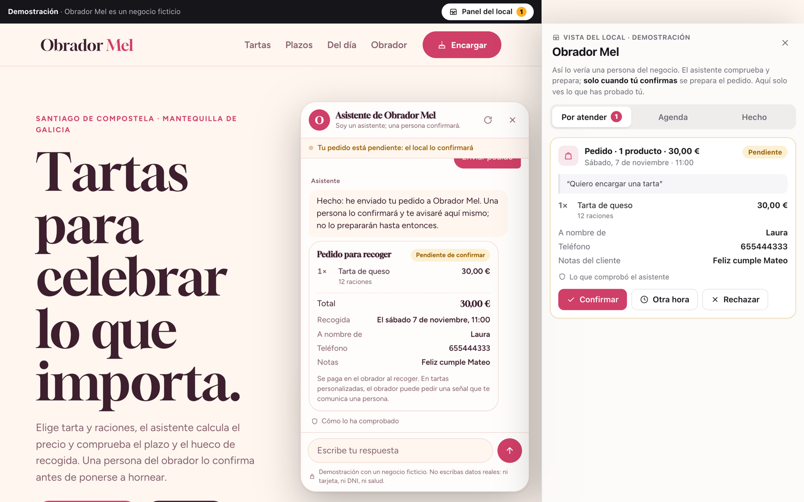
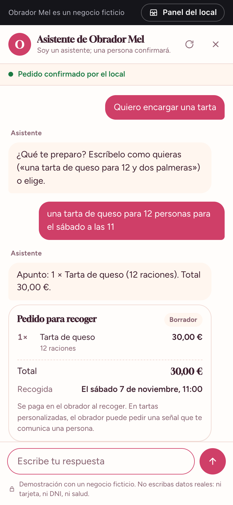

# Obrador Mel

A website for a fictional bakery in Santiago de Compostela, with a chat assistant that actually takes orders. It reads free text in Spanish or Galician, prices the order, checks lead times and pickup slots, and leaves everything ready for a person to confirm. Nothing is confirmed until someone at the bakery says so.

**[Live demo](https://mesa.cristiancode.dev/demo/pasteleria)** · **[Case study](https://cristiancode.dev/featured/obrador-mel)** · **[Documentation](https://cristiancode.dev/featured/obrador-mel/docs)**


The assistant is not a wrapper around a language model. It is a conversation engine written in plain JavaScript: most turns run in under 30 ms without any model, and prices, opening hours and availability are always computed from the data. A local model only writes the answers the data can't give directly, and every price, time and lead time it mentions is checked against the sources before anyone sees it.

## What it does

**For the customer**

- Understands a whole order in one sentence: *"Quiero una tarta de queso para 12 personas para el sábado a las 11"*.
- Asks only for what is missing, one thing at a time, with buttons where they help.
- Handles ellipsis (*"2 tartas de santiago y 1 de limón"*), ambiguity (*"una tarta"*: which one?), typos and changes of mind.
- Refuses a cake that can't be ready in time and offers days that work.
- Answers several questions in one message, and side questions in the middle of an order.
- Says when it doesn't know, and passes the question to a person instead of guessing.

**For the bakery**

- A staff panel to confirm, reject or propose another time, showing what the assistant checked.
- A full trail for each case: every decision, source and approval.



<p align="center"></p>

## How it works

```
Browser (Angular 22)
    │
    ▼
web/serve.mjs       static files and a closed API: allow-listed routes, rate limits
    │
    ▼
engine/server.mjs
    ├─ flow.mjs     the case: persistence and states
    ├─ dialog.mjs   a turn, as a pure function
    │    ├─ nlu, dates, orders    read the message
    │    ├─ ordering, booking     collect what is missing
    │    └─ info                  answer from the data
    ├─ kb.mjs       hybrid search and model answers
    └─ staff.mjs    a person decides
         │              │             │
         ▼              ▼             ▼
      Postgres        Qdrant        Ollama (local)
```

| Who decides        | What                                                                  |
| ------------------ | --------------------------------------------------------------------- |
| Rules              | Intent, language, products, quantities, dates and times               |
| The data           | Prices, opening hours, allergens, lead times and pickup slots         |
| The model, boxed in | Wording an answer from sources the engine hands it                   |
| A person           | Confirming, rejecting or changing an order                            |

A few things worth a look:

- **The turn is a pure function.** `turn()` touches no database or network, so a whole conversation can be tested in milliseconds.
- **No code path confirms an order.** Only `staffAct` can, and it requires a stored approval. This is structure, not a prompt.
- **It survives without the model.** If Ollama or Qdrant go down, search falls back to keywords and answers fall back to the source text. 31 of the 32 end-to-end conversations pass with both off, and CI runs them that way.
- **Privacy is tested where it matters.** Tests dump everything stored for a case and search it for the card number.
- **One runtime dependency in the engine:** `pg`.

## Run it

You need Node 24 and Docker. Ollama is optional: without it, search uses keywords only.

```bash
./scripts/up.sh                # Postgres, Qdrant, engine dependencies and tables
npm --prefix engine start      # the engine, on :8790
```

In another terminal:

```bash
npm --prefix web ci
npm --prefix web start         # the website, on http://127.0.0.1:4210
```

Add the model for written answers:

```bash
ollama pull qwen3.5:9b-mlx     # on Linux or Intel: qwen3.5:9b, and set it in .env
ollama pull nomic-embed-text
./scripts/ingest.sh
```

Try an order, then open **Panel del local** at the top right to confirm it.

## Tests

```bash
npm --prefix engine test                   # 139 unit tests, nothing running
npm --prefix engine run test:integration   # 26 tests against Postgres
npm --prefix web test                      # 10 tests against the production server
./scripts/eval.sh                          # 32 conversations over HTTP
```

## Stack

Angular 22 (zoneless, signals) · Node 24 · Postgres 16 · Qdrant · Ollama · GitHub Actions

## Documentation

There are 30 documents in [`docs/`](docs/README.md), in Spanish, like the product itself. Good places to start: [the overview](docs/01-overview.md), [real conversations](docs/28-conversations.md), [how a turn works](docs/17-conversation-engine.md) and [the decisions behind it](docs/09-decisions.md).

Obrador Mel is fictional. The address, phone and email are invented, and orders placed in the demo are test data.
